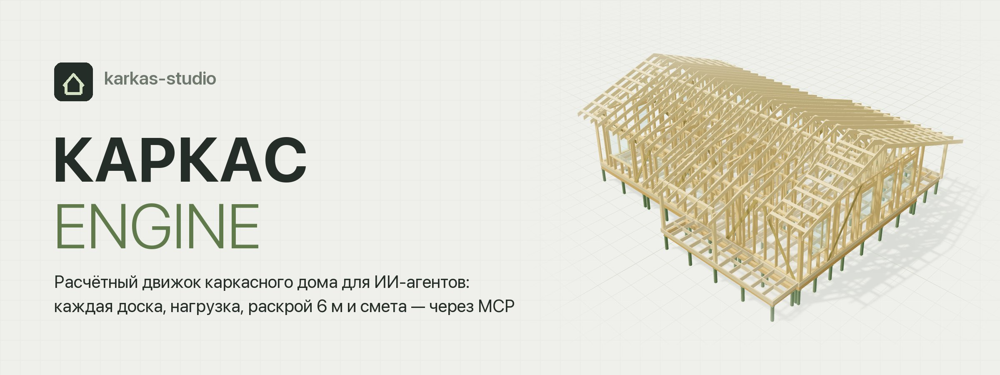
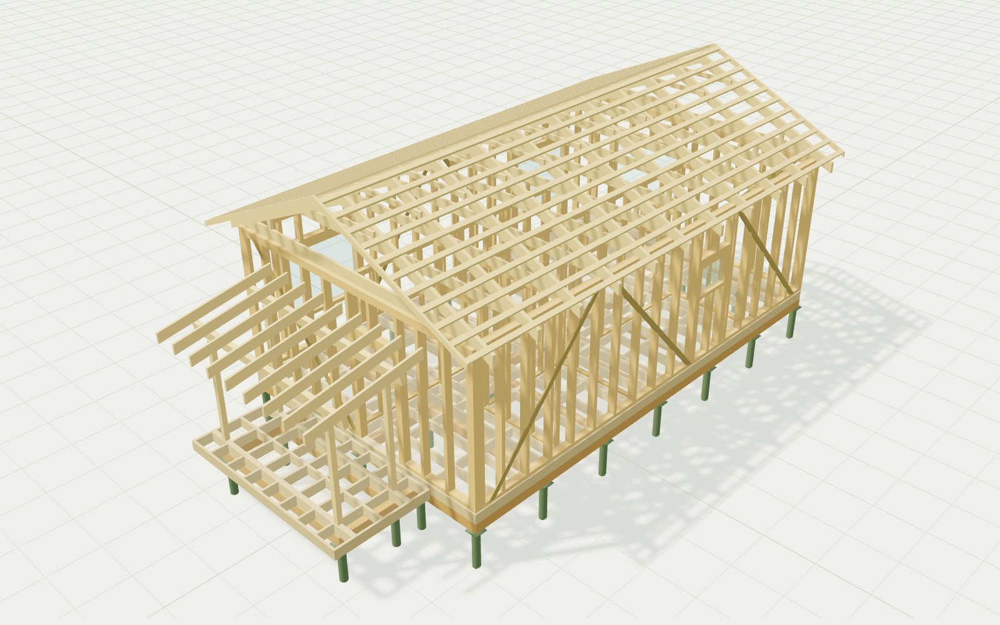
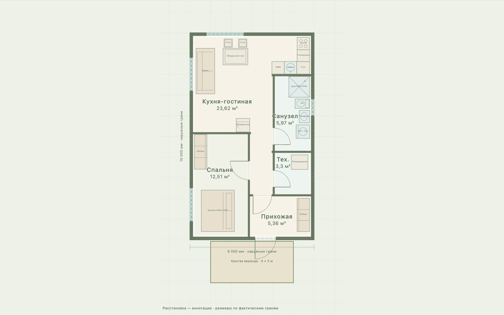
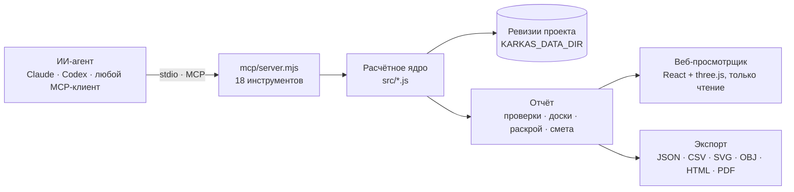
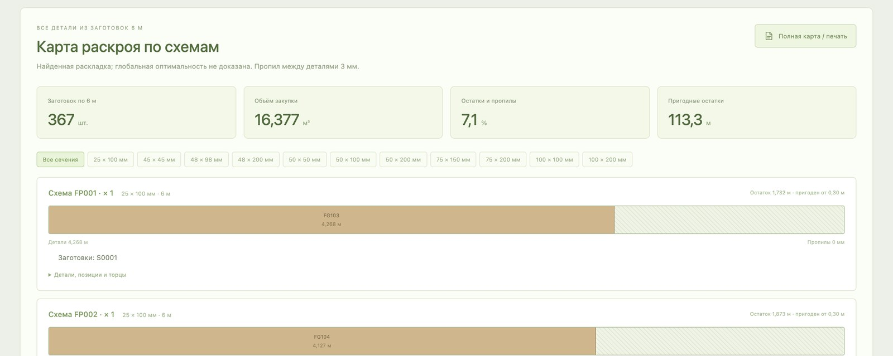
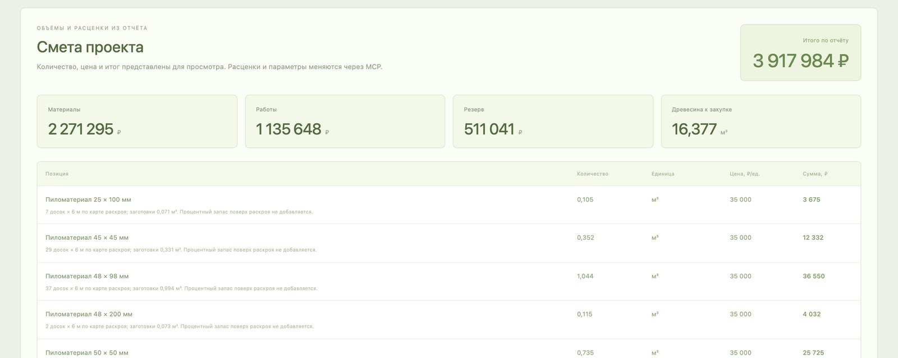
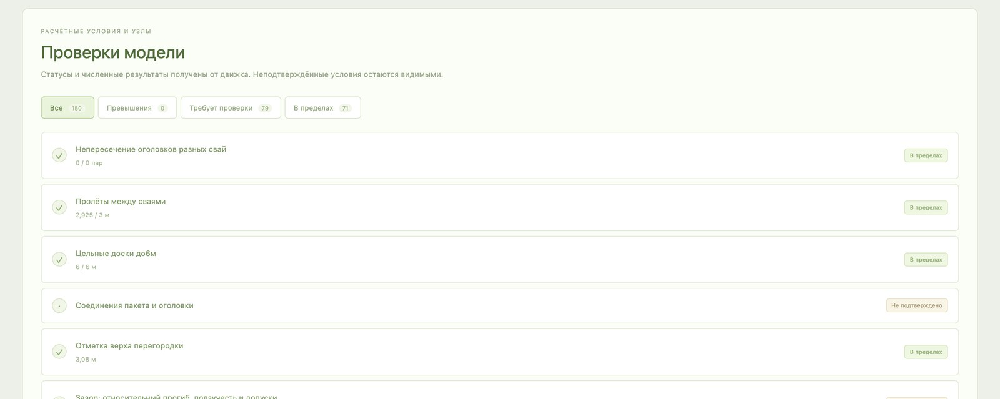
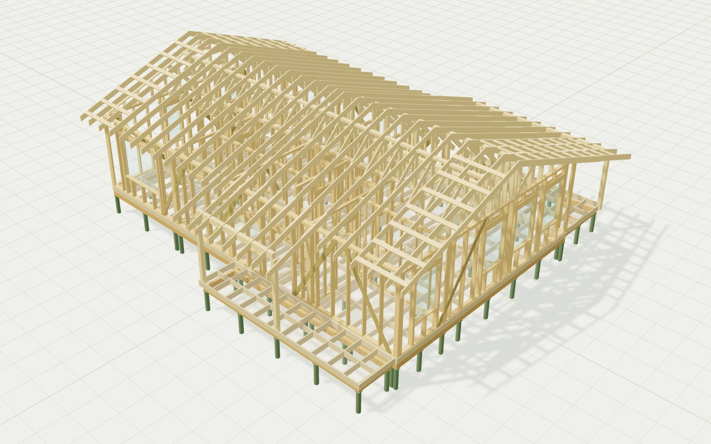

<p align="center">
  
</p>

<p align="center">
  
  
  
  
  
  
</p>

<p align="center">
  <a href="#быстрый-старт"><b>Быстрый старт</b></a> ·
  <a href="#mcp-инструменты"><b>Инструменты</b></a> ·
  <a href="#что-считает-движок"><b>Что считает</b></a> ·
  <a href="#примеры-проектов"><b>Примеры</b></a> ·
  <a href="docs/ENGINE.md"><b>Техническое описание</b></a>
</p>

---

**КАРКАС ENGINE** — расчётное ядро каркасного дома, которым управляет нейросеть через [Model Context Protocol](https://modelcontextprotocol.io). Модель описывает дом инструментами — контур, этажи, помещения, крышу, фундамент. Движок раскладывает его на настоящие доски с координатами и сечениями, считает нагрузки, прогибы и реакции свай, режет всё на заготовки по 6 м и собирает смету. Результат каждой ревизии открывается в веб-просмотрщике с 3D-моделью, планами и ведомостями и выпускается в JSON, CSV, SVG, OBJ, HTML и PDF-альбом КР.

Ручного редактора нет намеренно. Любое изменение — это JSON Patch с номером ревизии, поэтому каждую цифру в отчёте можно воспроизвести, а старые ревизии не меняются.

<table>
  <tr>
    <td width="50%"></td>
    <td width="50%"></td>
  </tr>
  <tr>
    <td align="center"><sub><b>Конструктивная модель.</b> Каждая доска — отдельный объект с массой, торцами и опорами</sub></td>
    <td align="center"><sub><b>Планировка.</b> Помещения, двери, оборудование и размеры по граням каркаса</sub></td>
  </tr>
</table>

## Как это работает



1. Агент вызывает `karkas_generate` или `karkas_import_project` и получает `project_id`, ревизию и хеш.
2. Читает `karkas_report`: проверки, крышу, фундамент, ведомость досок, раскрой.
3. Меняет конкретные поля через `karkas_apply_patch` с `expected_revision`. Патч сначала применяется к копии; если модель не прошла валидацию, ревизия не создаётся.
4. Для проваленных проверок получает от движка проверенные исправления: `karkas_propose_fixes` (или `karkas_analyze` с `fixes: true`) и `karkas_optimize` — поиск сочетания сечений и шагов до нуля отказов при минимальной стоимости.
5. Сравнивает до 12 вариантов через `karkas_compare_variants`, применяет лучший и выпускает документы через `karkas_export`.

## Что считает движок

| Блок | Что считает |
|---|---|
| 🪵 **Реальные доски** | Координаты, сечение, чистый объём, масса, косые торцы, пазы и выборки. Каждая деталь входит в нагрузку, раскрой и смету ровно один раз. |
| 🏗️ **Ростверк и сваи** | Пакетный ростверк из досок на ребро, оголовки, стыки на сваях, разбежка слоёв. Сумма реакций свай сверяется с полной вертикальной нагрузкой. |
| 📐 **Перекрытия и стены** | Лаги, обвязка, блокинг, усиления под стены. Высокие стены проверяются на изгиб от ветра, сжатие, устойчивость по Эйлеру и прогиб. |
| 🏠 **Кровля** | Стропила, фермы с поднятой пяткой, рамы с затяжкой (EA/EI-решатель с шарнирами), зонные крыши, свесы, импорт кровли из чертежа. |
| ❄️ **Нагрузки и физика** | Снег по нескольким схемам, ветер, точка росы и профили температуры и пара в слоях ограждения. |
| ✂️ **Раскрой 6 м** | Пропил, косые торцы, стыки и остатки. Метка оптимальности ставится только тогда, когда оптимум доказан. |
| 🧾 **Смета** | Закупка по фактической карте раскроя, без повторного запаса. Валюта EUR, RUB или USD, цены задаются явно. |
| 🌿 **Второй свет и пристройки** | U-образная лестница с косоурами и балясинами, галереи, терраса, крытая веранда, остеклённая веранда на общем или отдельном фундаменте. |

<table>
  <tr>
    <td width="33%"></td>
    <td width="33%"></td>
    <td width="33%"></td>
  </tr>
  <tr>
    <td align="center"><sub>Раскрой заготовок по 6 м</sub></td>
    <td align="center"><sub>Смета по фактической карте</sub></td>
    <td align="center"><sub>Проверки: в пределах, превышения, требуют проверки</sub></td>
  </tr>
</table>

> [!IMPORTANT]
> Движок не выдаёт разрешение на строительство. Нормативные сочетания нагрузок, геология, осадки, работа крепежа, смятие и узлы ферм остаются отдельными проверками. В отчёте они помечены как `unverified`, а не превращаются в `pass` из-за того, что модель хорошо выглядит. Подробности — в разделе [«Что считает ядро»](docs/ENGINE.md#что-считает-ядро).

## Быстрый старт

Нужен Node.js 22 или новее.

```sh
git clone https://github.com/woipot/karkas-studio.git
cd karkas-studio
npm ci
npm test          # 555 тестов: аналитические эталоны, геометрия, раскрой, MCP-клиент
npm run dev       # веб-просмотрщик с примерами проектов
```

### Подключение к MCP-клиенту

Добавьте stdio-сервер в настройки клиента (Claude Desktop, Claude Code, Codex и другие), заменив пути на свои:

```json
{
  "mcpServers": {
    "karkas-engine": {
      "command": "node",
      "args": ["/absolute/path/karkas-studio/mcp/server.mjs"],
      "env": { "KARKAS_DATA_DIR": "/absolute/path/karkas-data" }
    }
  }
}
```

Запускайте именно `node mcp/server.mjs`: баннер `npm run mcp` может попасть в stdout и сломать протокол. Без `KARKAS_DATA_DIR` проекты хранятся в `work/engine-data`.

Сервер также отдаёт ресурс `karkas://engine/capabilities` и промпт `design_frame_house` с порядком работы для модели.

<details>
<summary><b>Альбом КР в PDF</b></summary>

Для формата `structural_pdf` нужен Python с ReportLab:

```sh
pip install -r requirements-pdf.txt
```

Путь к интерпретатору можно передать через `KARKAS_PYTHON`.

</details>

### Полный цикл без UI

```sh
npm run demo
```

Скрипт подключает настоящий MCP-клиент, генерирует четырёхкомнатный дом, сравнивает варианты пакета ростверка, записывает выбранную ревизию и выпускает все форматы экспорта.

### Веб-интерфейс

`npm run dev` (или `npm run build` и любой статический хостинг `dist/`) открывает три режима — переключатель вверху страницы:

- **Просмотр проекта** (`/`) — опубликованные отчёты из `public/projects`, только чтение.
- **Новый дом** (`/?mode=new`) — мастер для человека без ИИ-агента: контур (прямоугольник или Г-образный), этажи и высота, комнаты с площадями, город и снег/ветер, крыша, бюджет. Генерация и полный расчёт (`generateHouse` + `evaluateHouse`) идут в Web Worker прямо в браузере; результат — те же 3D, план, проверки, материалы, раскрой и смета. Если в сборке есть `src/site-loads.js` (`siteLoads({city})`), нагрузки подставляются по городу; если есть `src/solutions.js` (`proposeFixes`, `optimize`), появляется вкладка «Исправления» с кнопками «Применить».
- **Редактор** (`/?mode=editor`) — ручное рисование стен, проёмов, узлов, зон крыши; ссылка «Полный расчёт и экспорт» отправляет проект в полное ядро.

«Скачать проект» сохраняет `{"project": …}` — ровно аргументы MCP-инструмента `karkas_import_project`. «Открыть JSON» принимает такой файл, голый проект или полный отчёт движка. Состояние мастера и редактора хранится в `localStorage` браузера.

## MCP-инструменты

| Инструмент | Что делает |
|---|---|
| `karkas_catalog` | Сечения, единицы, схемы, образец проекта и ограничения |
| `karkas_generate` | Дом из полигона или размеров, этажей и программы помещений; несущие стены, лестница, `site` → снег/ветер |
| `karkas_generate_options` | До 6 стратегий планировки, каждая рассчитана ядром; ранжированная таблица без записи |
| `karkas_site_loads` | Город или районы СП 20 → Sg, w0, тип местности, глубина промерзания (справочно) |
| `karkas_import_project` | Произвольный проект schema v2 |
| `karkas_list_projects` | ID, имена и актуальные ревизии |
| `karkas_get_project` | Исходные данные любой ревизии |
| `karkas_apply_patch` | Атомарный JSON Patch с проверкой ревизии |
| `karkas_analyze` | Итог и невыполненные проверки; `fixes: true` — до 3 проверенных исправлений на отказ |
| `karkas_report` | Планы, нагрузки, крыша, ростверк, укосины, доски, раскрой, смета, допущения |
| `karkas_compare_variants` | До 12 вариантов без изменения исходника; ранжирование по числу отказов, затем по сумме превышений u>1 |
| `karkas_propose_fixes` | Проверенные JSON Patch для проваленных проверок: before/after, новые отказы, разница стоимости |
| `karkas_optimize` | Детерминированный подбор сечений и шагов до нуля отказов при минимальной стоимости; `apply` создаёт ревизию |
| `karkas_set_second_light` | Второй свет одной транзакцией: проём, помещение, лестница, галереи |
| `karkas_add_annex` · `update` · `remove` | Терраса, крытая терраса, остеклённая веранда |
| `karkas_compare_foundations` | Сравнение ЖБ-свай, RR, RD и винтовых свай |
| `karkas_check_envelope` | R/U, точка росы, профили температуры и пара |
| `karkas_snow_cases` | Несколько схем снега на неизменных сечениях |
| `karkas_preview` | Локальный веб-просмотр ревизии, только чтение |
| `karkas_export` | JSON, CSV, SVG, OBJ, HTML-карта раскроя, альбом КР в PDF |

<details>
<summary><b>Пример: аргументы <code>karkas_generate</code></b></summary>

```json
{
  "name": "Дом 12×8 · четыре комнаты",
  "width": 12,
  "depth": 8,
  "levels": [{ "height": 2.8 }],
  "rooms": [
    { "name": "Кухня-гостиная", "area": 24, "minWidth": 3 },
    { "name": "Спальня", "area": 12, "minWidth": 2.5 },
    { "name": "Кабинет", "area": 10 },
    { "name": "Санузел", "area": 6 }
  ],
  "roof": { "shape": "mono", "pitch": 18, "framing": "auto" },
  "sections": {
    "walls": "50x150", "floor": "50x250", "roof": "50x200",
    "roofWeb": "50x100", "bracing": "25x100", "grillage": "50x200"
  },
  "foundation": { "spacing": 2, "capacity": 40, "grillage": { "plies": 3, "capSize": 250 } },
  "material": { "density": 500, "E": 10000, "Fb": 13, "Ft": 8, "Fc": 12, "Fv": 1.5 },
  "loads": { "snow": 1.5, "wind": 0.3 }
}
```

Числа — исходные допущения, а не нормативные значения. Координаты и длины в метрах, сечения в миллиметрах, силы в кН, напряжения и E в МПа.

</details>

<details>
<summary><b>Пример: изменение через <code>karkas_apply_patch</code></b></summary>

```json
{
  "project_id": "ID_FROM_GENERATE",
  "expected_revision": 1,
  "operations": [
    { "op": "replace", "path": "/floor/section", "value": "50x200" },
    { "op": "replace", "path": "/foundation/grillage/plies", "value": 4 }
  ]
}
```

При конфликте возвращается `REVISION_CONFLICT` с актуальным номером ревизии.

</details>

## Примеры проектов

В просмотрщике два сохранённых проекта, оба построены через MCP. Переключаются селектором «Проект дома» или параметром `?project=orion`.

<table>
  <tr>
    <td width="50%"></td>
    <td width="50%"></td>
  </tr>
  <tr>
    <td valign="top">
      <b>Ногинск · 6×10</b><br>
      <sub>Одноэтажный дом 57,6 м² с крытой верандой: 1066 досок, 6,8 т древесины, 367 заготовок по 6 м. Выпущен <a href="public/structural-album.pdf">альбом КР на 120 листов</a>, есть <a href="public/mcp-calls.jsonl">журнал MCP-вызовов</a>.</sub>
    </td>
    <td valign="top">
      <b>Орион · 13×14</b><br>
      <sub>Дом 122,6 м² на 89 сваях, кровля перенесена из исходного чертежа по векторным развёрткам: стропила с пазами, поперечины и фронтоны Ст-19/20.</sub>
    </td>
  </tr>
</table>

## Структура репозитория

```text
mcp/            MCP-сервер (stdio) и локальный read-only предпросмотр
src/            расчётное ядро, веб-просмотрщик и тесты (*.test.mjs)
scripts/        демо полного MCP-цикла, сборка примеров, PDF-альбом, импорт «Ориона»
public/         опубликованные снимки проектов: отчёты, CSV, OBJ, PDF, журналы MCP
docs/ENGINE.md  подробный справочник параметров и изменений по версиям
```

## Тесты

`npm test` проверяет аналитические эталоны нагрузок и прогибов, геометрию, массу и баланс реакций, раскрой и смету, планировку помещений и работу настоящего stdio-клиента: инициализация → генерация → ревизии → конфликт → сравнение → экспорт → read-only HTTP.

Ориентиры: [AWC — built-up beams](https://awc.org/faq/what-are-the-connection-requirements-for-built-up-beams/), [APA — wall bracing](https://www.apawood.org/applications-systems/fully-sheathed-wall-systems/wall-bracing/), [AWC — span tables](https://awc.org/resource-hub/span-table-tutorial/), [MCP TypeScript SDK](https://ts.sdk.modelcontextprotocol.io/v2/). Они не заменяют нормативную базу конкретного проекта.

---

<details>
<summary><b>In English</b></summary>

**KARKAS ENGINE** is a structural engine for timber-frame houses driven by an AI agent over the Model Context Protocol. The agent describes a house through tools; the engine turns it into real boards with coordinates and sections, computes loads, deflections and pile reactions, nests every part into 6 m stock, prices the purchase and exports JSON, CSV, SVG, OBJ, HTML and a PDF drawing set. Every change is a revision-checked JSON Patch, so results are reproducible. A read-only React + three.js viewer shows each revision. The interface and docs are in Russian.

</details>
